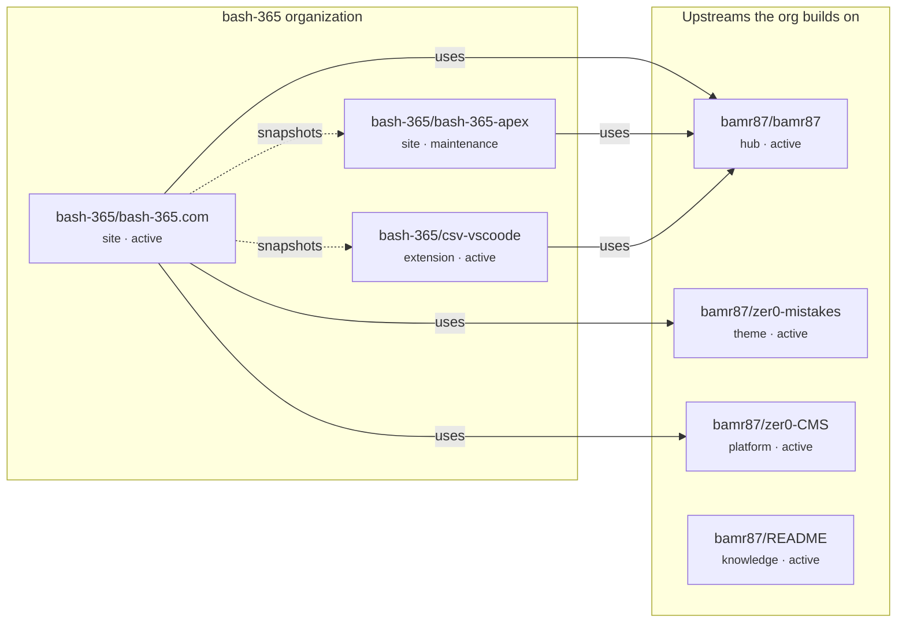

<!-- generated by scripts/brain/brain.py build — edit the sources, then rebuild; never edit by hand -->
# Org repositories

> Every repository the organization owns, and the upstream projects it builds on. Source: [`_data/org/repos.yml`](../../../_data/org/repos.yml).

| Repository | Role | Status | What it is |
| --- | --- | --- | --- |
| [bash-365/bash-365.com](bash-365-com.md) | member | active | BASH Consulting's website, its governed AI content pipeline, the Prompt Orchestrator VS Code extension, and the org… |
| [bash-365/bash-365-apex](bash-365-apex.md) | member | maintenance | Client-side redirect from the bash-365.com apex domain to www, served by GitHub Pages because the Microsoft 365 DNS… |
| [bash-365/csv-vscoode](csv-vscoode.md) | member | active | CSV Grid Editor, a VS Code extension published as bash-365.csv-grid-viewer: a spreadsheet grid over delimited files… |
| [bamr87/bamr87](bamr87.md) | upstream | active | The fleet hub: the Universal Project Standard (specs/), the kits fanned out to every repo, the reusable CI and AI… |
| [bamr87/zer0-mistakes](zer0-mistakes.md) | upstream | active | The Jekyll theme bash-365.com renders with (remote_theme). Every deliberate fork is declared in this repo's… |
| [bamr87/zer0-CMS](zer0-cms.md) | upstream | active | The content platform that reads this repo's zer0.json contract and runs the LinkedIn and X distribution lanes the… |
| [bamr87/README](readme.md) | upstream | active | The fleet-wide second brain: every fleet repository's documentation collected into one vault, served over its own… |
